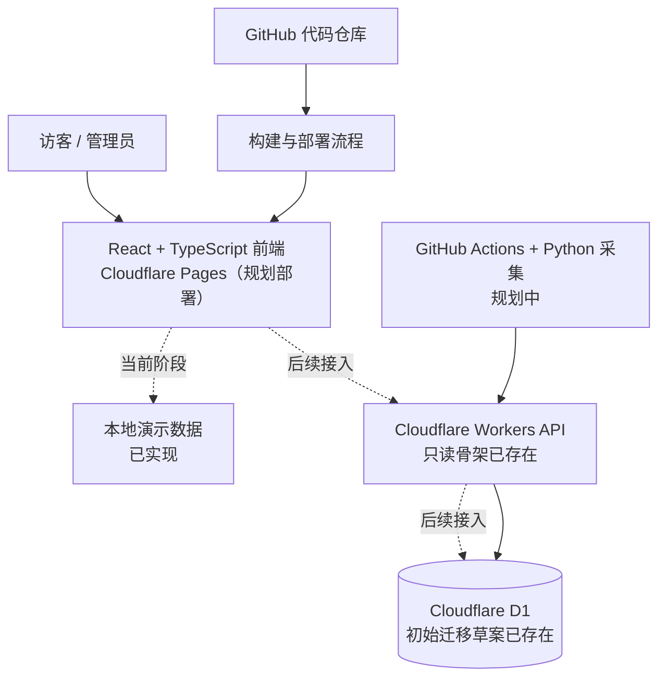
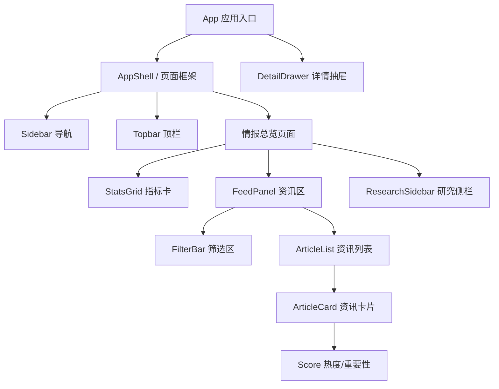
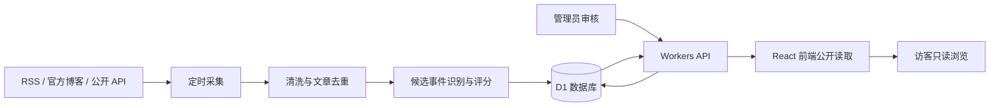

# AI Radar V1.2 — 系统架构图（开发阶段 1）

> 文档状态：阶段 1 前端工程化进行中。以下明确区分已实现与规划中的部分。

## 1. 全景图

## 2. 前端组件关系

## 3. 数据流（目标形态）

## 4. 已实现 / 未实现边界

| 部分 | 当前状态 | 说明 |
|---|---|---|
| React + TypeScript + Vite | 已实现基础工程 | 本阶段正在完成首页组件化 |
| 首页搜索、语言/专题/评分筛选 | 已实现（演示数据） | 仅在浏览器本地运行 |
| 资讯详情抽屉、收藏 | 已实现（演示数据） | 收藏仅保存在当前页面状态 |
| Workers API | 只读骨架 | 尚未接入正式环境与认证 |
| D1 schema | 初始迁移草案 | 尚未创建/迁移生产数据库 |
| 管理员登录与写 API | 未实现 | 上线前必须完成服务端认证和授权 |
| 自动采集与热度信号 | 未实现 | 后续接入 GitHub Actions |
| Pages 预览部署 | 未执行 | 不影响现有 V1 生产网站 |

## 5. 产品经理如何理解

- **前端**：你看到和点击的工作台。改布局、颜色、筛选交互，通常只需重新部署前端。
- **Workers 后端**：处理请求、权限和业务规则。改 API 或服务端逻辑才需要部署 Worker。
- **D1 数据库**：保存资讯和研究成果。新增表/字段时执行数据库迁移；普通新增文章不需要部署。
- **GitHub**：保存代码和迁移脚本，不是未来唯一的数据存储位置。
- **自动采集**：独立定时任务。采集规则变化时更新采集程序，不必然需要更新网站。

## 6. 版本更新原则

1. 前端、Worker、采集任务独立版本化。
2. 数据库迁移先在 staging 执行，备份后再考虑生产迁移。
3. API 使用版本化路径，优先保持向后兼容。
4. 不将未审核数据、管理员凭证或密钥打包进公开前端。
5. V1 正式站点保持不变，V1.2 在独立预览环境验收后再切换。
